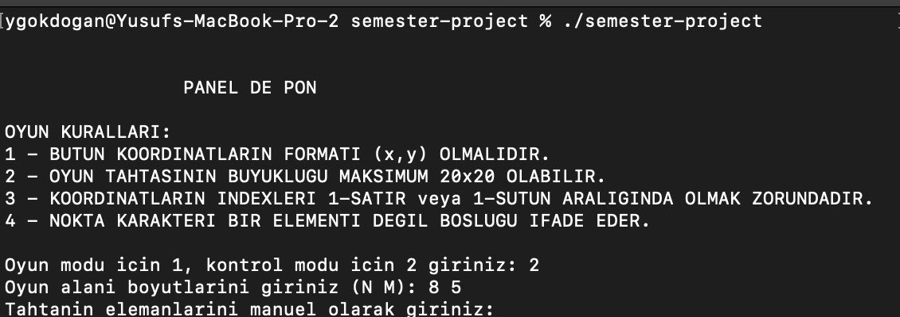
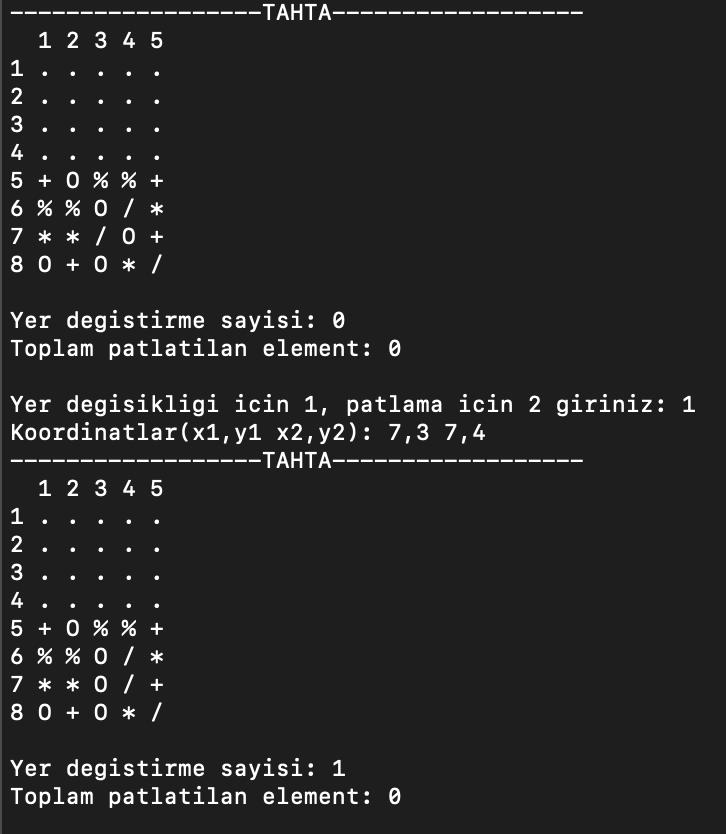
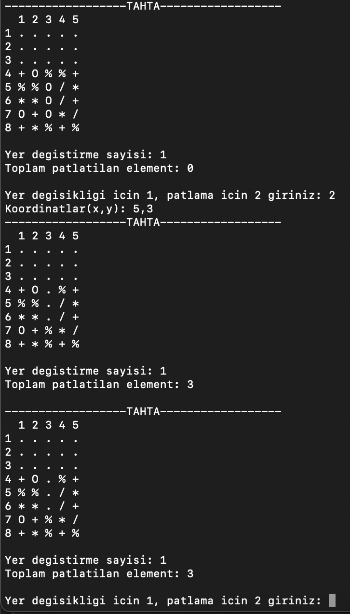
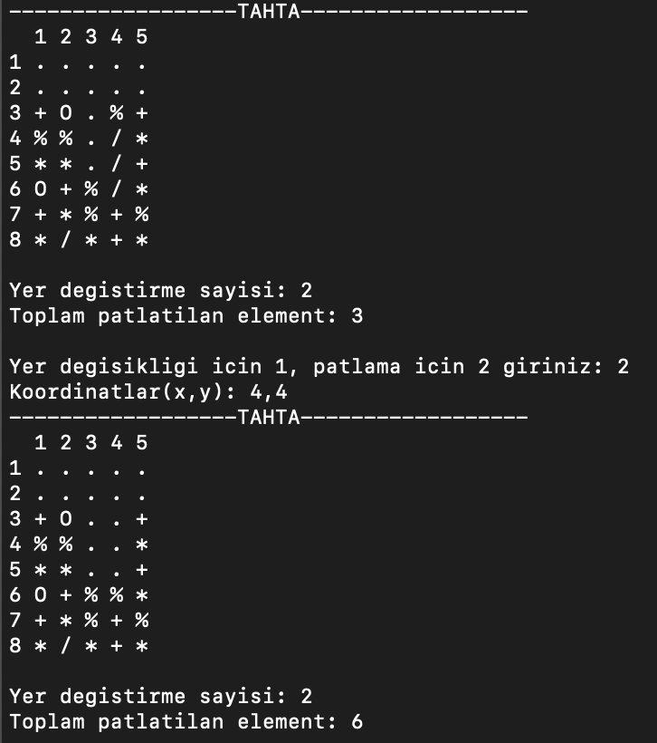
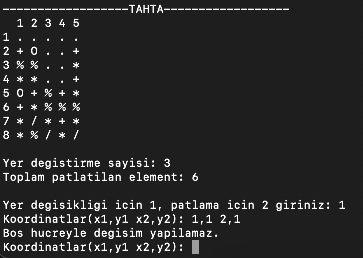
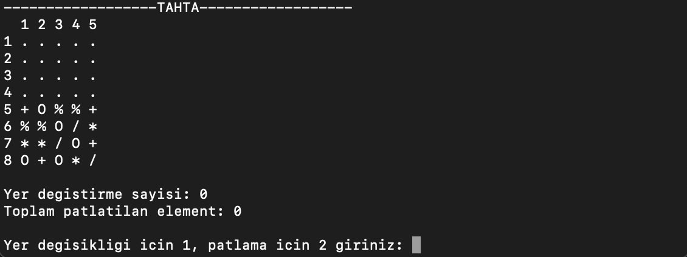
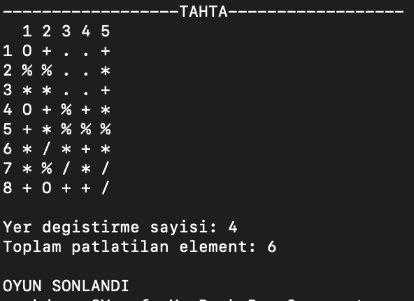

<div align="center">

# Panel de Pon · Terminal Edition

**Swap, match and clear symbols before the board hits the ceiling — right in your terminal.**

[](https://en.cppreference.com/w/c/11)
[](#build-and-run)
[](#build-and-run)

[Türkçe](README.tr.md) · **English**



</div>

---

A terminal puzzle game written in C, inspired by the mechanics of Panel de Pon. Swap cells, clear runs of matching symbols, and make room before the board reaches the top.

> [!NOTE]
> The in-game interface is in **Turkish**. No external libraries are required.

## Contents

- [Game mechanics](#game-mechanics)
- [Build and run](#build-and-run)
- [How to play](#how-to-play)
- [Screenshots](#screenshots)
- [Project structure](#project-structure)
- [Technical notes and limitations](#technical-notes-and-current-limitations)

## Game mechanics

| Mechanic | Details |
| --- | --- |
| **Configurable board** | Each dimension can be set from 1 to 20 |
| **Five symbols** | `*` `/` `+` `%` `O` — a dot (`.`) is an empty cell |
| **Two starting modes** | Random initialization, or manual input in control mode |
| **Match clearing** | Clear a run of ≥ 3 identical symbols extending right or down from the selected cell |
| **Gravity** | Symbols fall into empty spaces after a move |
| **Rising board** | A random row is added at the bottom after a valid swap |
| **Counters** | Number of swaps and total cleared symbols are displayed |

## Build and run

Open a **macOS / Linux** terminal with GCC or Clang installed, go to the project directory and run:

```sh
cc -std=c11 -Wall -Wextra panel_de_pon.c -o panel-de-pon
./panel-de-pon
```

> [!TIP]
> On Windows, use **WSL**. Native Windows builds need adjustments because the source uses `unistd.h` and `sleep()`.

## How to play

1. Choose `1` for game mode or `2` for control mode at startup.
2. Enter the board dimensions separated by a space, such as `8 6`.
3. Select an action from the menu and enter the requested coordinates.

| Menu | Action | Example input |
| :---: | --- | --- |
| `1` | Swap two cells | `7,2 7,3` |
| `2` | Clear matching symbols | `7,1` |
| `0` | Quit | — |

> [!IMPORTANT]
> Coordinates use the **`row,column`** format and **start at 1**. Don't include parentheses; separate two cells with a space. Rows go top → bottom, columns left → right. Swaps are intended for two occupied cells that are horizontally or vertically adjacent.

Matches are **not** cleared automatically — select `2` from the menu. For example, given this row:

```text
    1 2 3 4 5 6
7   * * * + O %
```

entering `7,1` clears the first three symbols. Matching scans only **right and down**, so select the leftmost or topmost cell of a run. If both directions contain a match of at least three, the longer run is cleared; ties favor the horizontal run.

After a swap, a new row pushes the board upward. **The game ends when a symbol remains in the top row.** There is a ~3 second delay between move displays.

<details>
<summary><b>Control mode</b></summary>

<br>

Control mode lets you manually enter the initially occupied lower section of the board to try specific matches. Cells are requested from the bottom row upward, left to right within each row. These prompts use **0-based indices**, while gameplay coordinates are **1-based**. Intermediate displays are not cleared in control mode; rows added after swaps are still random.

</details>

## Screenshots

<table>
  <tr>
    <td></td>
    <td></td>
  </tr>
  <tr>
    <td></td>
    <td></td>
  </tr>
</table>

<details>
<summary>More screenshots</summary>

<br>




</details>

## Project structure

```text
.
├── panel_de_pon.c  # Game loop, board, and move handling
├── screenshots/    # Gameplay screenshots
├── .gitignore      # Local files and build artifacts
├── README.md       # English documentation
└── README.tr.md    # Turkish documentation
```

## Technical notes and current limitations

The board is stored in a two-dimensional character array. Initial placement and new rows use `rand()`, seeded with `time(NULL)`.

| Function | Responsibility |
| --- | --- |
| `main()` | Game flow |
| `printBoard()` | Board rendering |
| `addRandomRow()` | Row insertion |
| `clearScreen()` | Screen clearing |

This version is a basic course project. Keep in mind:

- Input validation does not robustly handle nonnumeric or incomplete input.
- The swap code may still execute after an adjacency or empty-cell check reports an error. Selecting the same cell twice is also allowed.
- Out-of-bounds coordinates during a clearing action may cause invalid memory access; keep coordinates within the board.
- Matches are not automatically detected across the board, and there is no chain-clearing system.

The source code's existing behavior has been preserved. This repository demonstrates array operations, terminal input, and basic game logic.

---

<div align="center">

Made by [**Yusuf Emir Gökdoğan**](https://github.com/ygokdogan)

</div>
